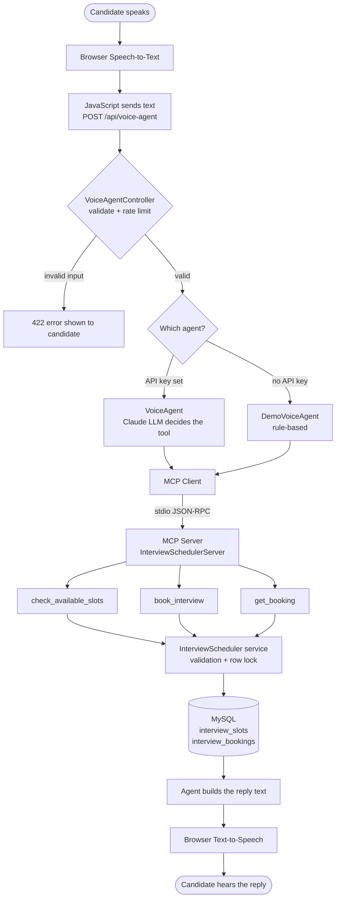
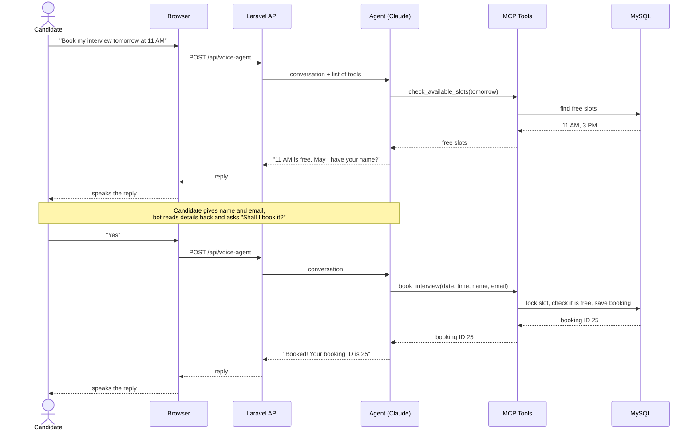
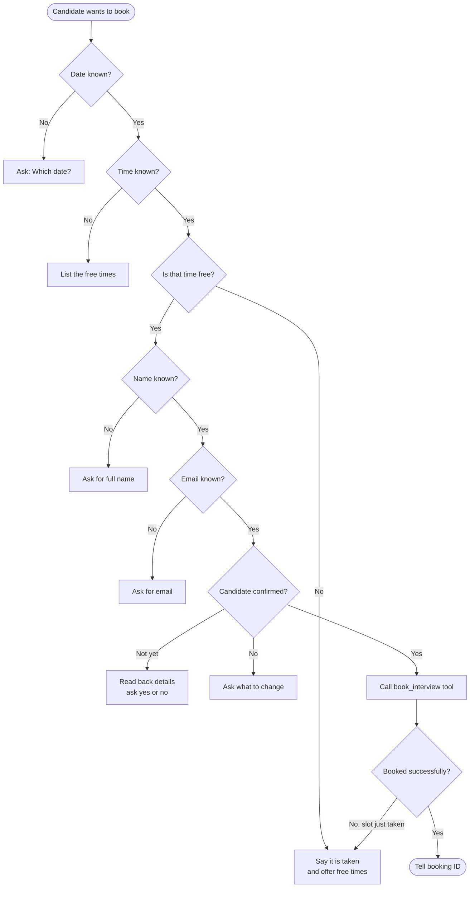

# Voice-Based AI Interview Scheduler — Interview Guide

Simple notes to help you explain this project step by step.

---

## 1. The 30-second explanation

> "I built a voice bot that lets candidates schedule interviews by speaking.
> The candidate says something like *'Book my interview tomorrow at 3 PM'*.
> The browser turns speech into text and sends it to my Laravel backend.
> An LLM (Claude) understands the request and decides which action is needed.
> It calls tools through MCP — check slots, book an interview, or get a booking.
> Laravel validates everything and saves it in MySQL.
> The reply is spoken back to the candidate using text-to-speech.
> The key idea: **the AI decides *what* to do, but Laravel decides *whether it is allowed*.**"

---

## 2. The big picture

```
Candidate speaks
      ↓
Browser: Speech-to-Text (Web Speech API)
      ↓
JavaScript sends text  →  POST /api/voice-agent
      ↓
Laravel controller (VoiceAgentController)
      ↓
Agent (Claude, or Demo mode)  ← decides which tool is needed
      ↓
MCP client  →  MCP server (InterviewSchedulerServer)
      ↓
MCP tools: check_available_slots | book_interview | get_booking
      ↓
InterviewScheduler service (validation + database lock)
      ↓
MySQL (interview_slots, interview_bookings)
      ↓
Reply text → Browser Text-to-Speech → Candidate hears it
```

---

## 2a. Flow charts

These diagrams render as pictures on GitHub. In VS Code, open the Markdown preview with **Ctrl+Shift+V**.

### Chart 1: System flow (how the parts connect)



### Chart 2: Booking, message by message



### Chart 3: Booking decisions (what the bot asks next)



---

## 3. Step-by-step: what happens when a candidate books

Example: the candidate says **"Book my interview tomorrow at 3 PM."**

| Step | What happens | Where in the code |
|------|--------------|-------------------|
| 1 | Candidate taps the mic. The browser listens and converts speech to text. | `resources/views/voice-bot.blade.php` (`SpeechRecognition`) |
| 2 | JavaScript sends the whole conversation (as text) to the backend. | `fetch('/api/voice-agent')` in the same file |
| 3 | Laravel validates the request: roles must be `user`/`assistant`, max 30 messages, max 2000 characters each, and rate-limited to 20 requests per minute. | `routes/api.php`, `app/Http/Controllers/Api/VoiceAgentController.php` |
| 4 | The controller picks the agent: **Claude** if an API key is set, otherwise **Demo mode**. | `VoiceAgentController::mode()` |
| 5 | The agent starts the MCP server and asks it, "Which tools do you have?" | `app/Services/Concerns/ConnectsToSchedulerMcp.php` |
| 6 | Claude reads the message plus the tool list and replies, "Call `check_available_slots` for 13 October." | `app/Services/VoiceAgent.php` |
| 7 | Our code runs that tool through MCP and sends the result back to Claude. This repeats until Claude has a final answer (the **agent loop**). | `VoiceAgent::reply()` and `runToolCalls()` |
| 8 | Claude asks for the name and email, reads the details back, and waits for **"yes"**. | System prompt in `VoiceAgent::systemPrompt()` |
| 9 | After "yes", Claude calls `book_interview`. | `app/Mcp/Tools/BookInterviewTool.php` |
| 10 | The tool validates the input, then the service **locks the slot row**, checks that it is still free and not in the past, creates the booking, and marks the slot booked. | `app/Services/InterviewScheduler.php` (`bookSlot`) |
| 11 | Claude replies: "Your interview is booked… Your booking ID is 1025." | `VoiceAgent.php` |
| 12 | The browser shows the reply and speaks it aloud. | `speak()` in the Blade file |

---

## 4. Each technology in one line

| Technology | What it does here |
|-----------|-------------------|
| **HTML/CSS/JS** | The chat page with a mic button, text box and suggestion buttons. |
| **Speech-to-Text** | The browser's `SpeechRecognition` API, set to Indian English (`en-IN`). |
| **Text-to-Speech** | The browser's `speechSynthesis` API reads the reply aloud. |
| **PHP + Laravel** | Routes, controllers, validation, service classes, and the database layer (Eloquent). |
| **MySQL** | Two tables: `interview_slots` (date, time, interviewer, status) and `interview_bookings` (slot, name, email, status). |
| **LLM API (Claude)** | Understands natural language such as "tomorrow at 3" and decides which tool to call. |
| **Agentic AI** | The loop where the AI picks a tool, sees the result, and decides the next step on its own. |
| **MCP** | A standard way for an AI app to **discover** tools and **call** them. Our tools live in an MCP server. |
| **REST API** | `GET /api/interview-slots`, `POST /api/interview-bookings`, `GET /api/interview-bookings/{id}`, `POST /api/voice-agent`. |

---

## 5. MCP explained simply

- **MCP server** = a "toolbox" that says: *"I have 3 tools. Here are their names, descriptions and inputs."*
  → `app/Mcp/Servers/InterviewSchedulerServer.php`
- **MCP tool** = one action, with a JSON schema for its inputs.
  → `app/Mcp/Tools/*.php`
- **MCP client** = the agent side. It starts the server, lists the tools, and calls them.
  → `ConnectsToSchedulerMcp.php` (uses `laravel/mcp`)
- **Transport** = stdio. The agent starts `php artisan mcp:start interview-scheduler` as a small background process and talks to it using JSON-RPC.

**Why MCP?** The tools are written once and can be used by any MCP-compatible AI client, not just our app. For example, the same server could be plugged into Claude Desktop or another agent.

**Why only local (not on the web)?** The `book_interview` tool creates real bookings, so I did not expose the MCP server publicly without authentication.

---

## 6. Security points (interviewers love these)

1. **The LLM never touches the database.** It can only request a tool. Laravel validates the input and runs the query.
2. **One shared rule book.** The REST API and the MCP tools both use `InterviewScheduler`, so the rules are the same everywhere.
3. **No double booking.** `lockForUpdate()` inside a DB transaction locks the slot row while booking. If two people book at the same moment, the second one gets "already booked". There is also a unique index in the database.
4. **No past bookings.** Slots that have already started are rejected.
5. **Booking lookup needs ID + email.** Otherwise anyone could guess `1, 2, 3…` and read other people's bookings.
6. **Confirmation before booking.** The bot reads back the details and books only after "yes".
7. **Input limits and rate limiting** on `/api/voice-agent` (20 requests/minute), because each call costs money.
8. **The API key stays in `.env`** on the server, never in the browser.
9. **No HTML injection.** Replies are shown with `textContent`, not `innerHTML`.
10. **Friendly errors.** Candidates see a simple message; the real error goes to the Laravel log.

---

## 7. Demo mode (be honest about this)

- If no Anthropic API key is set, the app uses `DemoVoiceAgent`, which matches simple patterns (dates, times, emails, "yes/no") **instead of an LLM**.
- It still uses the **same MCP tools, validation and database**, so the full flow can be shown.
- The page shows a yellow **"Demo mode"** badge.
- In the interview, say: *"Demo mode is a rule-based fallback so the flow can be tested without an API key. With the key set, Claude handles the understanding."*

---

## 8. Likely interview questions and simple answers

**Q: What is Agentic AI here?**
A: The AI does not just answer text. It decides which action to take (check slots, book, or look up), calls a tool, looks at the result, and decides the next step, in a loop, until the task is done.

**Q: Why not let the LLM write SQL directly?**
A: It is unsafe and unpredictable. The LLM could make mistakes or be tricked by the user. Tools with fixed inputs and server-side validation are much safer.

**Q: How do you stop two candidates booking the same slot?**
A: A database transaction with `lockForUpdate()` on the slot row, a status check, and a unique index on the bookings table.

**Q: How does the bot understand "tomorrow"?**
A: The system prompt gives Claude today's date in IST, so it can work out "tomorrow" or "next Monday". Demo mode calculates it with Carbon.

**Q: What if the user says their email by voice?**
A: Speech-to-text writes "asha dot rao at gmail dot com". The bot converts it to `asha.rao@gmail.com` and reads it back for confirmation.

**Q: What if the AI service is down?**
A: The error is caught, logged, and the candidate sees a friendly "please try again" message with a **Try again** button.

**Q: How is conversation memory handled?**
A: The browser keeps the conversation and sends it with each request, so the API stays stateless. The server validates it every time.

**Q: How did you test it?**
A: Feature tests for the booking API, for each MCP tool (including double-booking and past-slot cases), for the voice-agent endpoint, and for the demo conversation flow.

**Q: What would you improve next?**
A: Send an email confirmation, add rescheduling and cancellation, add login/OTP for candidates, support Hindi, and connect a real phone line (for example via a telephony API).

---

## 9. Interview-day checklist

**The day before or that morning:**

```bash
cd /var/www/html/interview-scheduler
php artisan interview:reset-demo     # deletes ALL bookings, creates slots for the next 5 weekdays
php artisan config:clear
php artisan serve
```

Slots are created only for the **next 5 weekdays from the day you run the reset**. If you run it a week early, "tomorrow" may have no slots, so run it on the day.

**Before you share your screen:**

1. Open `http://localhost:8000/voice-bot` in **Chrome**, using a normal window rather than incognito, so microphone permission is remembered.
2. Click the mic once and **allow microphone access**.
3. Check that the internet is on, because Chrome's speech recognition needs it.
4. Turn your speaker volume up so the interviewer hears the bot.
5. Click the ↻ (new conversation) button to start clean.

**A good 2-minute demo script:**

1. "What slots are available tomorrow?" (the bot lists the times)
2. "11 AM" (it asks for your name)
3. Say your name (it asks for your email)
4. Say "yourname dot test at gmail dot com" (it converts the spoken email and reads it back)
5. "Yes" (it books the slot and tells you the booking ID)
6. "Check my existing booking" → the booking ID → the email (it reads out the booking details)
7. Show the double-booking guard: "Book tomorrow at 11 AM" (it says 11 AM is not free)

**If something goes wrong:**

| Problem | Fix |
|---|---|
| Mic button is greyed out | Use Chrome or Edge, and open the page via `localhost`, not an IP address |
| "Microphone access is blocked" | Click the lock icon in the address bar → Microphone → Allow |
| No slots for tomorrow | Run `php artisan interview:reset-demo` |
| "Sending messages very quickly" | Wait one minute; the limit is 20 messages per minute |
| Voice misunderstands you | Type the message instead; the same flow works |

## 10. How to run with real AI

To use Claude instead of demo mode, set `ANTHROPIC_API_KEY=...` and `VOICE_AGENT_MODE=auto` in `.env`, then run `php artisan config:clear`.
